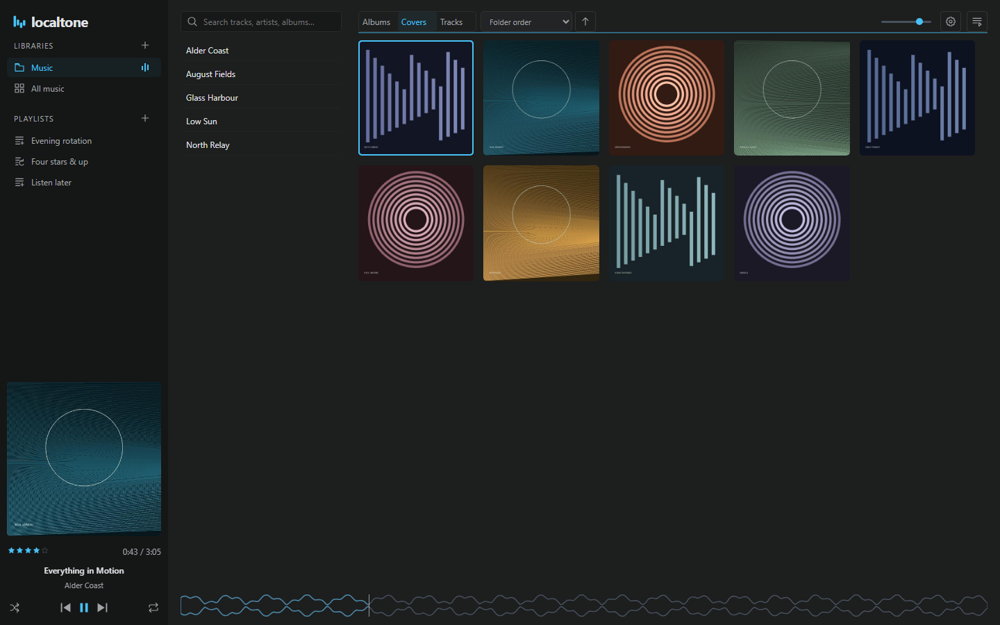
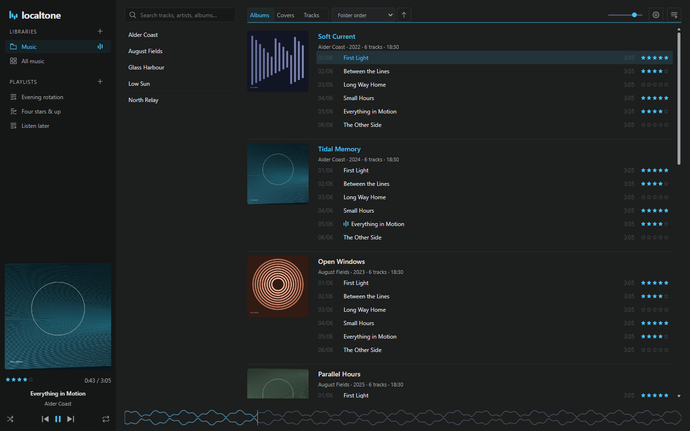
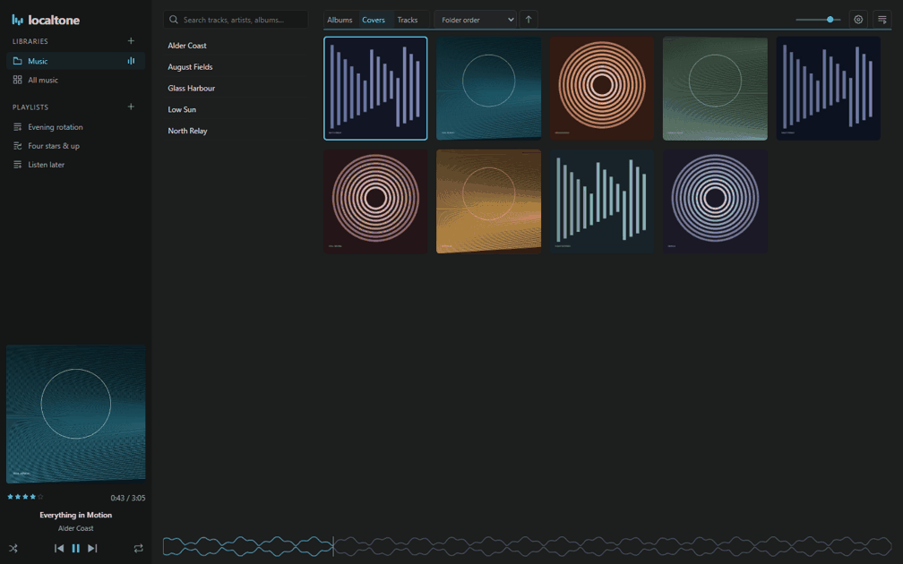
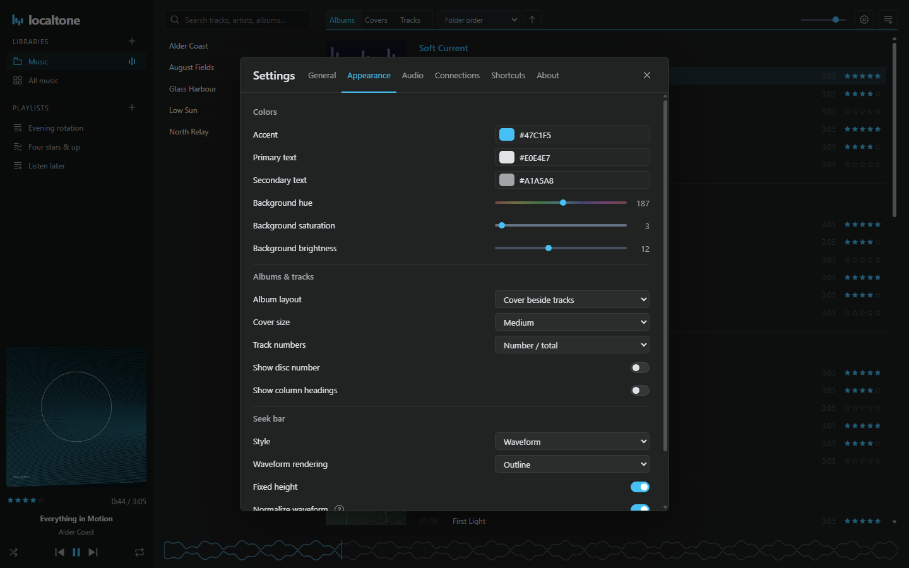

# Localtone

A compact, keyboard-driven music player for **Windows, macOS and Linux**. Browse your own collection, build playlists and edit tags in one quiet desktop interface.

**[Download 1.1.0](https://github.com/shn1ggy/localtone/releases/tag/v1.1.0)** · [User guide](docs/USER-GUIDE.md) · [Roadmap](docs/ROADMAP.md) · [Report a bug](https://github.com/shn1ggy/localtone/issues/new/choose)



*Actual app at 100% zoom, with a fictional demo collection and original artwork.*

## Your collection, your way

- **Browse comfortably.** Artist pane, expandable album lists, cover grid and compact tracks; adjustable panes and columns.
- **Stay on the keyboard.** Navigate panes and albums, rate tracks, edit tags and control playback with configurable shortcuts.
- **Make useful playlists.** Drag selections into regular playlists, or use rules and search expressions for dynamic ones.
- **Look after your files.** MP3 tag editing with optional MusicBrainz proposals, track-number tools and previewed file/folder renaming.
- **Keep listening.** Waveform seeking, shuffle/repeat, playback queue, mini player, output selection and optional Last.fm scrobbling.
- **Pick up where you left off.** Saved playback and browsing state, customizable appearance and portable app data.

Browsing filters do not restrict the normal playback queue. Your music remains in your folders; no account is required for local playback.

## Download

**Version 1.1.0 · Stable release.** These are ready-to-run desktop packages; Node.js is not required.

| System | Download |
| --- | --- |
| Windows · 64-bit | [App ZIP](https://github.com/shn1ggy/localtone/releases/download/v1.1.0/Localtone-1.1.0-win-x64.zip) |
| macOS · Apple Silicon | [App ZIP](https://github.com/shn1ggy/localtone/releases/download/v1.1.0/Localtone-1.1.0-mac-arm64.zip) |
| macOS · Intel | [App ZIP](https://github.com/shn1ggy/localtone/releases/download/v1.1.0/Localtone-1.1.0-mac-x64.zip) |
| Linux · 64-bit | [AppImage](https://github.com/shn1ggy/localtone/releases/download/v1.1.0/Localtone-1.1.0-linux-x86_64.AppImage) |

Extract the **complete ZIP** into a writable folder and open Localtone, or make the Linux AppImage executable. Windows portable EXE, Linux ZIP, checksums and matching decoder sources are on the [release page](https://github.com/shn1ggy/localtone/releases/tag/v1.1.0). GitHub’s “Source code” download is for development.

Windows packages are unsigned. Mac apps are ad-hoc signed but **not Apple notarized**; macOS may require approval in Privacy & Security. Automated checks run on all three systems; broader hardware, audio-device and accessibility testing is ongoing.

### Start listening

1. Choose **Add library…** and select your music folder.
2. Browse Albums, Covers or Tracks; double-click a track to play.
3. Use the **+** beside Playlists, or open **Settings** to make Localtone yours.

Portable mode keeps **Localtone-data** beside the app. Keep it when updating. Settings → About shows the active data folder and update tools. [Update safely](docs/USER-GUIDE.md#updates-and-storage) · [Move your library](docs/USER-GUIDE.md#move-a-library-to-another-computer)

## A closer look



<details>
<summary>Keyboard demo: cycle views and open the queue</summary>



X cycles the browsing views; P opens the queue. Captured from the running app; the demo uses synthesized audio.

</details>

<details>
<summary>Appearance preferences</summary>



</details>

[Keyboard controls](docs/USER-GUIDE.md#keyboard-essentials) · [Search and dynamic playlists](docs/USER-GUIDE.md#search-and-dynamic-playlists) · [Tags and file tools](docs/USER-GUIDE.md#edit-tags)

## Help shape Localtone

Try it with your collection and [report reproducible problems](https://github.com/shn1ggy/localtone/issues/new/choose). Different library layouts, audio devices and keyboard workflows are especially helpful. Please remove private paths and credentials from reports.

See the [roadmap](docs/ROADMAP.md) for priorities and [CONTRIBUTING.md](CONTRIBUTING.md) for development guidance. [Privacy](docs/PRIVACY.md) · [Security](SECURITY.md) · [Release notes](CHANGELOG.md)

## Run from source

Use **Node.js 24 LTS, 24.15 or newer** (see [.nvmrc](.nvmrc) and [package.json](package.json) for the tested version and supported ranges):

```sh
npm ci
npm start
```

On Windows you can also double-click `Start-Localtone.cmd`; it installs dependencies on the first run and starts the app.

```sh
npm run verify
npm run benchmark
```

For native packaging and decoder setup, see [RELEASING.md](docs/development/RELEASING.md). UI and maintenance references: [design rules](docs/development/DESIGN.md), [renderer structure](docs/development/RENDERER-STRUCTURE.md), [maintenance](docs/development/MAINTENANCE.md), [release readiness](docs/development/RELEASE-READINESS.md). Native audio and platform behavior require real-system testing in addition to automated checks.

## License

Localtone-owned code and original project assets are **GPL-3.0-or-later**. Third-party components retain their own licenses. See [LICENSE](LICENSE) and [LICENSING.md](LICENSING.md).
